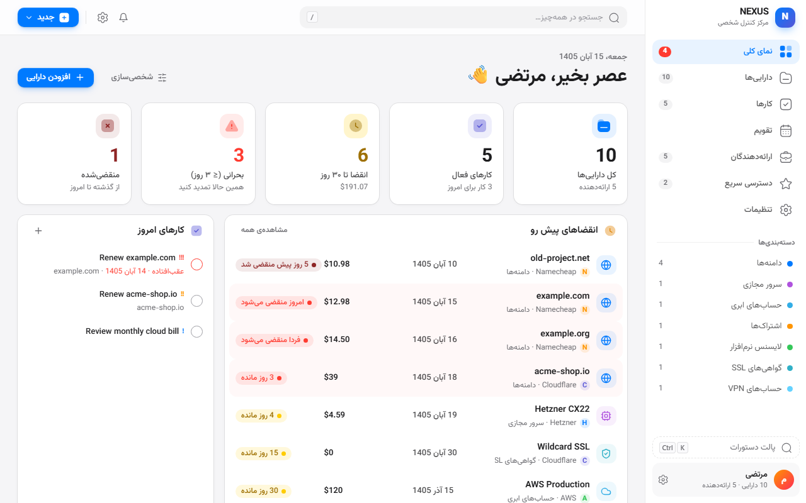
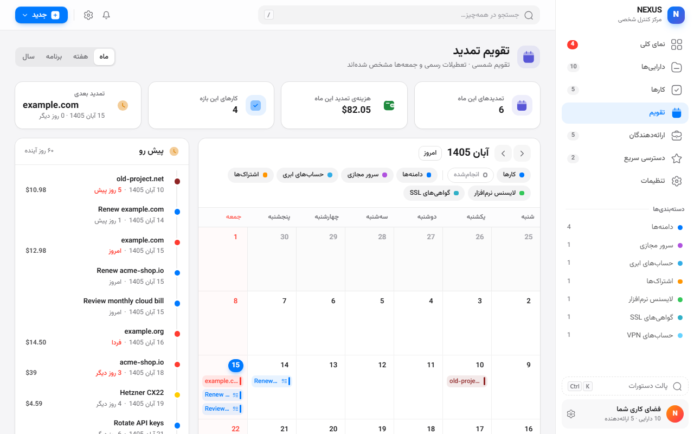
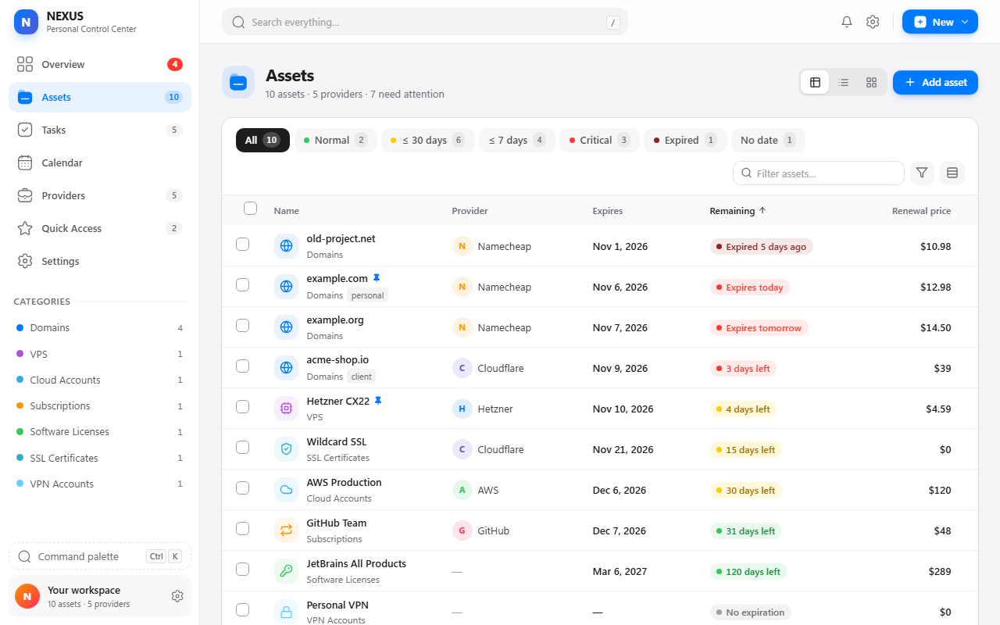
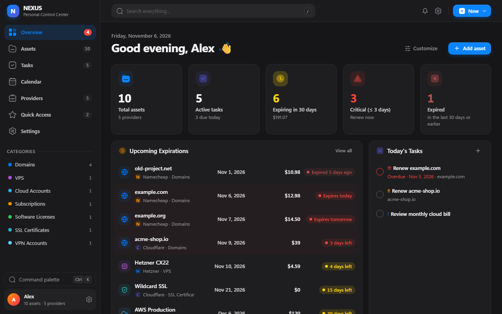

<div align="center">


# NEXUS — مرکز کنترل شخصی

**دامنه، هاست، سرور، اشتراک و لایسنس‌هایتان را یک‌جا مدیریت کنید — با یادآور انقضا، تقویم شمسی تمدید و مدیریت کارها.**
رایگان، متن‌باز و کاملاً آفلاین؛ هیچ اطلاعاتی از کامپیوتر شما خارج نمی‌شود.

[**⬇️ دانلود آخرین نسخه**](../../releases/latest) · [English](#english)

</div>

<p align="center">
  
  
</p>

## ویژگی‌ها

- **پیگیری انقضا** — شمارش معکوس خودکار؛ زرد از ۳۰ روز مانده، قرمز از ۳ روز مانده.
- **یادآور هوشمند** — اعلان دسکتاپ ۳۰، ۱۵، ۷، ۳ و ۱ روز قبل و روز انقضا؛ حتی وقتی افزونه بسته است.
- **تقویم تمدید** — نمای ماهانه، هفتگی، برنامه و سالانه؛ تقویم شمسی با تعطیلات رسمی و جمعه‌ها؛ جمع هزینه‌ی تمدید هر ماه.
- **مدیریت کارها** — اولویت، زیرکار، کار تکراری، کار مرتبط با دارایی و ساخت خودکار کار تمدید.
- **ارائه‌دهندگان** — پارس‌پک، نت‌افراز، ایران‌سرور، Cloudflare، … با لینک پنل و همه‌ی سرویس‌هایتان نزد هر کدام.
- **دسته‌بندی و فیلد سفارشی**، جستجوی سراسری، پالت دستورات (`Ctrl+K`)، ویرایش گروهی.
- **فارسی و انگلیسی** با چیدمان کامل راست‌به‌چپ، حالت روشن و تاریک، قیمت به تومان.
- **حریم خصوصی** — بدون حساب کاربری و بدون سرور؛ رمزنگاری اختیاری AES-256 برای رمزهای عبور؛ خروجی و ورود JSON/CSV.

## نصب (۲ دقیقه)

1. از صفحه‌ی [**Releases**](../../releases/latest) فایل `nexus-x.y.z.zip` را دانلود کنید.
2. فایل را در یک پوشه‌ی **دائمی** (مثلاً `Documents\NEXUS`) از حالت فشرده خارج کنید. اگر این پوشه پاک شود، افزونه از کار می‌افتد.
3. در Chrome (یا Edge / Brave) آدرس `chrome://extensions` را باز کنید.
4. گوشه‌ی بالا **Developer mode** را روشن کنید.
5. روی **Load unpacked** بزنید و همان پوشه را انتخاب کنید.
6. از آیکون پازل 🧩 کنار نوار آدرس، NEXUS را سنجاق کنید. داشبورد کامل: `Alt+Shift+D`.

> زبان و تقویم: **تنظیمات › عمومی** (فارسی/English، شمسی/میلادی).

### آپدیت به نسخه‌ی جدید
اطلاعاتتان را از دست ندهید:
1. در NEXUS: **تنظیمات › مدیریت داده‌ها › خروجی JSON** (پشتیبان).
2. zip جدید را دانلود کنید و فایل‌هایش را **جایگزین** محتوای همان پوشه‌ی قبلی کنید.
3. در `chrome://extensions` روی دکمه‌ی ↻ کارت NEXUS بزنید. (دکمه‌ی **Remove** را نزنید — اطلاعات پاک می‌شود.)

### انتقال به کامپیوتر دیگر
روی کامپیوتر اول **خروجی JSON** بگیرید، روی کامپیوتر دوم افزونه را نصب کنید و از **تنظیمات › مدیریت داده‌ها › انتخاب فایل… › ادغام** واردش کنید.

## حریم خصوصی

همه‌ی داده‌ها فقط در حافظه‌ی محلی مرورگر شما (`chrome.storage.local`) ذخیره می‌شوند. افزونه هیچ درخواست شبکه‌ای ندارد و فقط سه مجوز می‌خواهد: `storage`، `alarms`، `notifications`. جزئیات: [PRIVACY-POLICY.md](release/store/PRIVACY-POLICY.md).

---

<a id="english"></a>

## English

**NEXUS** is a free, open-source Chrome extension for tracking domains, hosting, VPS, cloud accounts, subscriptions and licenses — with expiry reminders, a renewal calendar (Gregorian or Shamsi), tasks and providers. 100% local: no account, no server, no tracking.

<p align="center">
  
  
</p>

### Install
1. Download `nexus-x.y.z.zip` from [**Releases**](../../releases/latest) and unzip it into a permanent folder.
2. Open `chrome://extensions`, enable **Developer mode**, click **Load unpacked** and select the folder.
3. Pin NEXUS from the 🧩 menu. Full dashboard: `Alt+Shift+D`. Language & calendar: *Settings › General*.

**Update:** export a JSON backup, replace the folder's files with the new zip's contents, then press ↻ on the NEXUS card (don't click *Remove* — it deletes the data).

### Build from source

Requires Node.js 18+.

```bash
npm install
npm test               # unit tests (dates, Shamsi conversion, reminders, import/export…)
npm run build          # -> dist/   (load this folder unpacked)
npm run release        # -> release/nexus-<version>.zip
```

Stack: React 18, TypeScript, Vite, Tailwind CSS, Lucide + Iconly icons, Manifest V3 (service worker, `chrome.alarms`, `chrome.notifications`, `chrome.storage.local`).

```
src/background/   service worker: reminder scheduler + notifications
src/lib/          business logic: dates & Jalali calendar, reminders, storage, i18n, crypto, search
src/components/   shared UI (forms, detail drawer, command palette, date picker)
src/dashboard/    full-page app (Overview, Assets, Tasks, Calendar, Providers, Quick Access, Settings)
src/popup/        toolbar popup
tests/            vitest unit tests
```

### License
[MIT](LICENSE). Bundled: Vazirmatn font (SIL OFL 1.1), React (MIT), Lucide (ISC), react-iconly (MIT).
